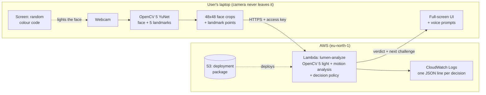
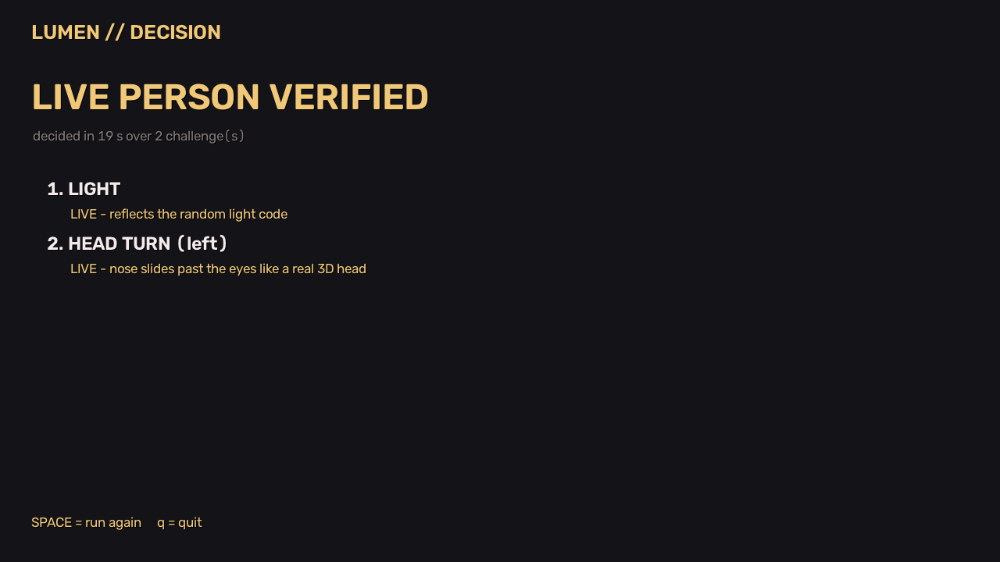
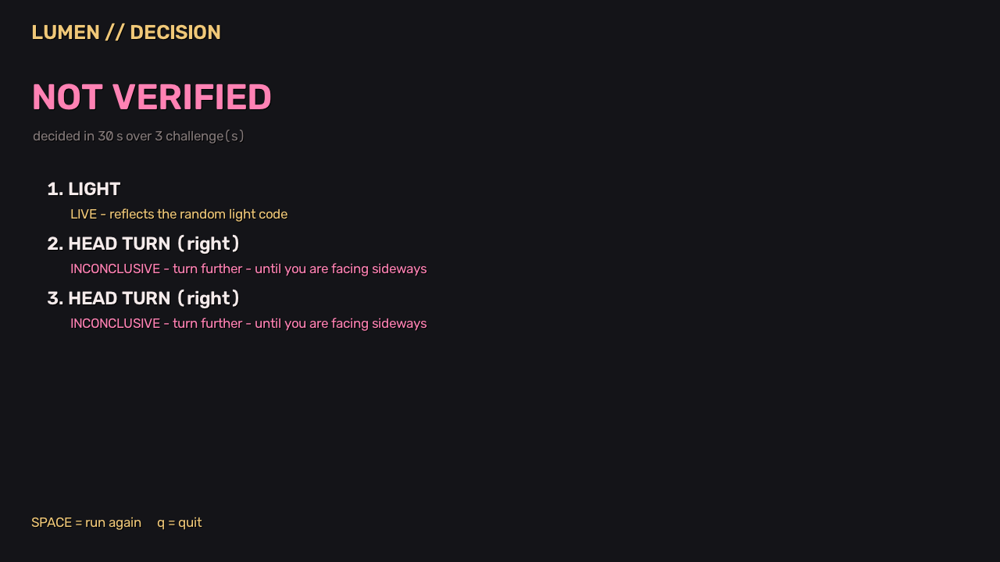

# LUMEN

**Proof-of-life face verification that interrogates a face with light and motion, so a printed photo, a screen replay or an injected video cannot pass as a live person.**


## Project Overview

Face checks in online exams, banking onboarding and remote sign-ins can be fooled by a photo held up to the camera, a phone replaying a video, or a deepfake fed in as a virtual webcam. LUMEN challenges the face instead of just looking at it: the screen flashes a random colour code that only a real, nearby 3D face reflects back, and the person is asked to turn their head in a random direction, which only a real head can do with true depth. Each check covers the other's blind spot, and the OpenCV 5 analysis and decision run on AWS Lambda while video never leaves the user's device.

## Features

- **Light challenge** — a random red/green/blue flash code; OpenCV 5 measures whether the face reflects it in time, in colour and with 3D relief. A replayed or injected video cannot react to a code it has never seen.
- **Head-turn challenge** — a random left/right prompt; tracks how far the nose slides past the eyes, which a flat photo or screen cannot reproduce.
- **Two-challenge decision policy** — *verified* only when both pass; *not a live person* when the light code is not reflected; *referred to a human* after two inconclusive attempts.
- **Cloud analysis on AWS Lambda** — the laptop sends only 48×48 face crops and 5 landmark points per frame; OpenCV 5 runs in Lambda, every decision is logged to CloudWatch, nothing is stored.
- **Spoken guidance** — prompts and results are read aloud (offline, OS voice).
- **Safety and privacy by design** — flashes stay under 3 changes per second (photosensitivity guideline); no video is saved during verification; access key on the cloud endpoint.
- **Research tools** — remote-pulse (rPPG) scanner, clip recorder and batch analysers used to build and evaluate the checks.

## Tech Stack

| Layer | Tools |
|---|---|
| Vision | OpenCV 5.0 — YuNet face detector (`FaceDetectorYN`), `getPerspectiveTransform`, `GaussianBlur`, colour-space masks, least-squares response fitting |
| Signal processing | NumPy, SciPy (POS rPPG, band-pass filtering) |
| Cloud | AWS Lambda (Python 3.12, function URL), Amazon S3 (deployment package), Amazon CloudWatch Logs, IAM |
| Client | Python, OpenCV HighGUI full-screen UI, Windows System.Speech voice |

## Architecture



## Screenshots / Demo

▶ **Demo video (≤ 5 min):** https://youtu.be/Vt1LJn4vxYY

Decision screens from real round-2 sessions analysed on AWS Lambda:

| Live person: light + head turn passed | Phone video: passed light, failed head turn |
|---|---|
|  |  |

## Installation

```bash
git clone https://github.com/fsafva13-coder/lumen.git
cd lumen
python -m venv .venv
# Windows: .venv\Scripts\activate   |   macOS/Linux: source .venv/bin/activate
pip install -r requirements.txt
python scripts/download_models.py
```

**Deploy the cloud function** (in AWS CloudShell, no local tools needed): upload `cloud/lumen-cloud.zip`, then

```bash
unzip -o lumen-cloud.zip -d lumen-cloud && cd lumen-cloud && bash deploy.sh
```

The script builds OpenCV 5 for Lambda, creates the function, its log-only IAM role and a key-protected URL, and runs a test call.

## Usage

```bash
# Full verification session, analysis on AWS Lambda
python scripts/05_verify.py --cloud <FUNCTION_URL> --key "<ACCESS_KEY>"

# Same session, analysed locally (no cloud)
python scripts/05_verify.py

# Evaluation runs: add the ground-truth label, then score all sessions
python scripts/05_verify.py --cloud <URL> --key "<KEY>" --label real --subject p01
python scripts/score_sessions.py --md results/sessions.md

# Individual challenges and research tools
python scripts/03_light_challenge.py --label real --subject p01
python scripts/04_head_turn.py --label real --subject p01
python scripts/02_pulse_scan.py
```

Keys in the session window: `SPACE` start / run again, `q` quit. **Warning:** the light challenge flashes full-screen colours; do not use it with anyone who has photosensitive epilepsy.

## Project Structure

```
lumen/
├── lumen/                  # core library
│   ├── face.py             # YuNet tracker, landmark smoothing, skin sampling
│   ├── light.py            # light challenge: codes, capture, analysis, verdict
│   ├── motion.py           # head-turn challenge: nose-shift analysis, verdict
│   ├── policy.py           # decision policy (which challenge next, final decision)
│   ├── challenges.py       # interactive challenge screens
│   ├── remote.py           # client for the AWS Lambda function
│   ├── camera.py           # webcam setup, exposure lock/calibration
│   ├── pulse.py            # POS remote-pulse (research)
│   ├── voice.py            # spoken prompts
│   └── hud.py              # overlay drawing
├── cloud/
│   ├── handler.py          # Lambda entry point
│   └── deploy.sh           # one-command CloudShell deployment
├── scripts/                # 01-05 interactive tools, recorders, analysers, scoring
├── models/                 # YuNet ONNX (OpenCV Zoo)
├── data/                   # local clips and session logs (git-ignored)
└── docs/                   # report, diagrams, screenshots
```

## Results / Metrics

Small pilot evaluation: one laptop webcam, 2 consenting participants, 1 phone and 2 printed magazine photos — evidence the method works on this setup, not proof that it generalises. Metrics follow ISO/IEC 30107-3: **APCER** = attacks accepted as live, **BPCER** = real people not verified. Thresholds were set on the first clips; later clips were recorded after the thresholds were fixed.

**Full sessions (analysis on AWS Lambda)**

| Round | Presented | Sessions | Verified | Rejected | Referred to human | Median time |
|---|---|---|---|---|---|---|
| 2 (final policy) | Real (2 people) | 10 | **9** | 1 | 0 | 18 s |
| 2 (final policy) | Phone photo / video | 11 | **1** | 3 | 7 | 26 s |
| 1 (first policy) | Real (2 people) | 10 | 5 | 4 | 1 | 18 s |
| 1 (first policy) | Phone photo / video | 7 | 0 | 4 | 3 | 13 s |

Round 2: **APCER 9% (1/11), BPCER 10% (1/10)**, all 21 sessions analysed on AWS Lambda. One bright phone photo, swivelled hard, passed both checks by a narrow margin (reflection gain 0.11 vs a 0.10 floor; nose shift 0.65 vs 0.60), and one real session was rejected with a gain of 0.099. Round 1 rejected real faces on 3D relief; that rule was removed and two thresholds relaxed *using round-1 data* before round 2. Details, failure analysis and limitations: [`docs/REPORT.md`](docs/REPORT.md).

**Individual challenges (recorded clips)**

| Check | Real faces | Phone screen | Printed photo |
|---|---|---|---|
| Light: reflection strength | 16–42% | ~2% (4/4 rejected) | 18–187% (paper reflects too) |
| Light: verdict | 7/7 live | 4/4 fake | still, close-up print passed 2/2 → light alone is not enough |
| Head turn: nose shift (needs ≥ 0.60) | 0.92–2.82 on far turns | ≤ 0.25 | ≤ 0.46 |
| Head turn: verdict | 9/10 far turns passed (1 turned the wrong way) | 0/9 passed | 0/9 passed |

## Challenges & Learnings

- **Remote pulse on a laptop webcam was too weak to trust.** Webcam brightness flicker (0.3–0.5%) exceeded the pulse itself (~0.1%); real and fake clips overlapped, so pulse was kept as a research tool, not a decision input.
- **Paper reflects light like skin.** The light challenge reliably rejects screens but passed a steady printed photo; this is why the head turn is mandatory.
- **A first head-turn method failed.** Plane-parallax with 5 detector landmarks let swivelled photos through; measuring a *far* turn, where the nose slides past the eyes, separated them.
- **Hand-held motion faked 3D relief** in the reflection map; a stillness gate and a split-half relief estimate removed it.
- **Webcam exposure control mattered.** Locked manual exposure made frames too dark or too slow; exposure is now locked only during the flashes and calibrated to keep ~15–30 fps.

## Future Improvements

- Larger, more diverse evaluation (skin tones, glasses, lighting, more devices and attack types including masks and live deepfakes)
- Adaptive agent that picks the next challenge from the evidence so far (designed as a drop-in replacement for `policy.py`)
- Browser client (WebRTC) so verification runs without installing Python
- Denser facial landmarks for a lower head-turn threshold

## Demo / Live Link

- Cloud endpoint: AWS Lambda function URL — available to judges on request (access key required)
- Video (≤ 5 min): https://youtu.be/Vt1LJn4vxYY

## License

MIT — see `LICENSE`. YuNet model © OpenCV Zoo contributors (MIT).
