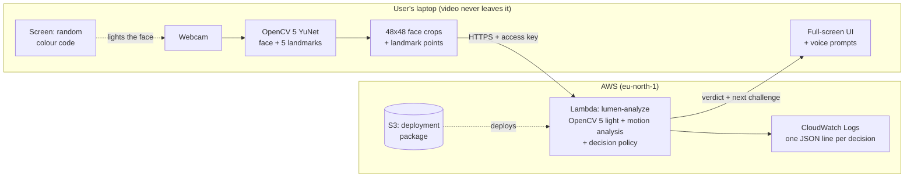

# LUMEN — Technical Report

**Proof-of-life face verification with light and motion challenges, analysed with OpenCV 5 on AWS Lambda**

OpenCV AI Competition 2026 (powered by AWS) · Solo entry · Fathima Safva · October 2026

Demo video: https://youtu.be/Vt1LJn4vxYY · Code: https://github.com/fsafva13-coder/lumen

---

## 1. Problem

Face checks are now a routine gate: remote exams, bank and wallet onboarding, account recovery, age checks. Most of them only ask *"is there a face, and does it match?"* They are routinely beaten by **presentation attacks**: a printed photo held to the camera, a phone replaying a video of the victim, or a deepfake stream injected as a virtual webcam. Commercial liveness products exist, but they are closed, costly, and often depend on special hardware such as depth sensors or infrared cameras.

**LUMEN asks a different question: can an ordinary laptop webcam and screen prove that a live, three-dimensional person is present right now?** It does this by *challenging* the face rather than just looking at it.

## 2. Users and beneficiaries

- **Remote exam and interview platforms**, to deter a stand-in holding up a photo or replaying a recording.
- **Small fintechs, NGOs and public services** that need low-cost remote identity checks without special hardware.
- **End users**, who are protected from having their photos and videos reused to impersonate them.

## 3. How it works

A verification session runs two challenges chosen by a policy:

| Challenge | What the user experiences | What OpenCV 5 measures | What it defeats |
|---|---|---|---|
| **Light** | The screen flashes a random red/green/blue code for about 6 s | Whether the face's colour follows the code in **time** and **colour** | Screen replays and injected video, which cannot react to a code they have never seen |
| **Head turn** | A spoken prompt asks for a turn to a random side until facing sideways | How far the nose slides past the eyes, and in which direction | Printed photos and screens: a flat image cannot show this parallax |

**Decision policy** (`lumen/policy.py`):

- **Verified:** light *live* and head turn *live*.
- **Not a live person:** light challenge not reflected (*fake*).
- **Referred to a human:** two inconclusive attempts at either challenge, for example from too much movement or too small a turn.

Each challenge covers the other's blind spot, a finding of this project (section 7). The light code is random per session (`secrets.randbits`), and the turn direction is random and checked, so a pre-recorded response cannot anticipate either.

## 4. Architecture



**Client (laptop, Python):** controls the camera and full-screen display, detects the face with OpenCV 5's `FaceDetectorYN` (YuNet), crops the inner face to 48×48 during the light challenge, records 5 landmarks per frame during the head turn, and speaks prompts with the operating system's voice.

**Cloud (AWS Lambda):** `cloud/handler.py` receives a challenge's measurements, runs the OpenCV 5 analysis and the decision policy, returns the verdict and next action, and writes one structured JSON line per decision to CloudWatch (session id, verdict, features, analysis time).

## 5. OpenCV 5 implementation

- **Face and landmarks:** `cv.FaceDetectorYN` (YuNet, OpenCV Zoo) gives the face box and 5 landmarks. The landmarks are smoothed with an exponential filter for colour sampling and kept raw for motion analysis. During the locked-exposure light challenge, detection runs on a brightened copy (`cv.convertScaleAbs`) while measurements use the original pixels.
- **Light challenge** (`lumen/light.py`):
  1. Each frame's inner face is resampled to 48×48 (`cv.resize`, `INTER_AREA`), and skin pixels are selected in YCrCb (`cv.cvtColor`, `cv.inRange`).
  2. The screen-to-camera delay is found by searching lags of 0–450 ms.
  3. A least-squares model *pixel = offset + drift + Σ gain_c · code_c(t − lag)* is fitted per channel. From it: **code match (R²)**, **relative reflection gain**, **colour fidelity** (diagonal dominance of the 3×3 emitted-to-camera matrix), and the same gain for the background.
  4. A per-pixel reflection map (`cv.GaussianBlur`) gives a **3D-relief** estimate computed from two halves of the code so that only structure present in both counts. Relief is reported but does not decide (section 7).
  5. Frames straddling a colour change are discarded.
- **Head-turn challenge** (`lumen/motion.py`): a frontal reference is taken from the first 1.7 s. The nose's sideways shift relative to the eye midpoint, in eye distances, is tracked through the turn. A real head turned toward profile moves the nose past the eyes (shift ≥ 0.6), and the sign must match the requested direction. A plane-parallax test using `cv.getPerspectiveTransform` is also computed and reported (section 7).
- **Camera control** (`lumen/camera.py`): raw YUY2 capture. Exposure is locked only during the flashes, so the camera cannot cancel them, and is calibrated to the longest exposure that keeps at least about 15 fps.
- **Research tools:** remote pulse (POS rPPG, band-pass with SciPy, SNR) and recorders and analysers for every component.

## 6. AWS deployment

| Item | Detail |
|---|---|
| Compute | AWS Lambda, Python 3.12, x86_64, 1024 MB, 30 s timeout, `eu-north-1` |
| Package | `opencv-python-headless==5.0.0.93` + NumPy (70 MB zip), stored in S3 because it exceeds the direct-upload limit |
| Endpoint | Lambda function URL (HTTPS) protected by a shared access key in an environment variable. The key never appears in the repository. |
| Permissions | Dedicated IAM role with only `AWSLambdaBasicExecutionRole` (write logs) |
| Observability | One JSON log line per decision in CloudWatch Logs |
| Data handling | Face crops and landmarks exist only in memory for one request. Nothing is written to disk or a database. |
| Reproducibility | `cloud/deploy.sh` builds, uploads, creates the role, function and URL, and runs a test call. It can be re-run from AWS CloudShell with no local tooling. |
| Cost | Within the AWS Free Plan credits |

## 7. Evaluation

**Setup:** one Windows laptop webcam (640×480 at 30 fps), one smartphone, two printed magazine photos, and two consenting participants (`p01`, `p02`) from one household. Metrics follow ISO/IEC 30107-3: **APCER**, the share of attack sessions accepted as live, and **BPCER**, the share of real-person sessions not verified.

### 7.1 Component experiments (recorded clips)

| Experiment | Result |
|---|---|
| Remote pulse (15 clips) | Real and fake overlapped (SNR −5.2 to +1.2 dB for real; −6.9 to −0.3 dB for fake). Webcam flicker of 0.3–0.5 % exceeded the pulse of about 0.1 %. **Not used for decisions.** |
| Light challenge vs phone screen | Reflection gain was about 2 % on the phone against 16–42 % on real faces. 4/4 phone clips rejected; 7/7 real clips live. |
| Light challenge vs printed photo | Paper reflects light much as skin does (gain 18–187 %). A still, close-up print passed 2/2 times. **The light challenge cannot stop prints on its own.** |
| Head turn, first method (plane parallax) | Swivelled photos scored 0.05–0.22 against 0.09 for a moderate real turn, so the method failed. |
| Head turn, final method (far turn) | Real far turns gave a nose shift of 0.92–2.82 (9/10 passed; 1 turned the wrong way). Swivelled prints reached at most 0.46 (0/9 passed) and phones at most 0.25 (0/9 passed). The 10 attack clips recorded after the threshold was fixed all failed. |

### 7.2 Full sessions on AWS, round 1 (policy v1)

| Presented | Sessions | Verified | Rejected | Referred | Median time |
|---|---|---|---|---|---|
| Real | 10 | 5 | 4 | 1 | 18 s |
| Phone (photo + video) | 7 | 0 | 4 | 3 | 13 s |

**APCER 0 % (0/7); BPCER 50 % (5/10).** The logged features showed why: on the final camera settings, real faces' 3D relief was 0.19–0.31 against a 0.26 cut-off, and one real code match was 0.84 against 0.85.

**Change made after round 1 (policy v2):** relief is no longer allowed to reject anyone. It had already failed against still prints, and the mandatory head turn covers prints. The code-match cut-off became 0.80 and the movement limit 6 % of face width. **These thresholds were adjusted using round-1 data. Round 2 was recorded fresh afterwards.**

### 7.3 Full sessions on AWS, round 2 (policy v2, final)

| Presented | Sessions | Verified | Rejected | Referred | Median time |
|---|---|---|---|---|---|
| Real (p02 ×5, p01 ×5) | 10 | **9** | 1 | 0 | 18 s |
| Phone photo / video | 11 | **1** | 3 | 7 | 26 s |

**APCER 9 % (1/11); BPCER 10 % (1/10).** All 21 sessions were analysed on AWS Lambda.

- Of the 10 attacks that were stopped, 7 were stopped at the light challenge (3 rejected as *not reflected*, 4 referred after repeated movement) and 3 passed the light challenge but failed the head turn (nose shift at most 0.41).
- One real session needed a second light attempt because of movement and took 31 s.

**The accepted attack (most important failure case).** A phone photo at high screen brightness:

- **Light challenge:** code match R² 0.91 and reflection gain **0.11**, just above the 0.10 floor. Real faces in round 2 had 0.15–0.69. Its relief was 1.79, far outside the real range of 0.27–0.40.
- **Head turn:** swivelled hard, it reached a nose shift of **0.65**, just over the 0.60 threshold. Real heads in round 2 gave 1.0 or more, and in the pilot 0.92 or more.

Both margins were thin. Earlier, the highest swivelled photo had reached 0.46.

**The rejected real session.** Participant p01 sat further from the screen (face 142 px) and produced a reflection gain of 0.099, just under the floor, together with a code match of 0.77. The light floor therefore sits where a bright phone and a distant real face overlap.

**Fixes identified but deliberately not applied** (there was no time left to re-test them honestly):

- Raise the head-turn threshold to about 0.9. Every real far turn so far gave at least 0.92; the accepted attack gave 0.65.
- Add an upper bound on relief, since a phone's reflection map is far more uneven than a face's.
- Normalise the reflection gain by face-to-screen distance.

### 7.4 Failure cases and limitations

- **Small sample.** There were 21 final sessions with 2 participants from one household on one camera. The results show the method works on this setup, not that it generalises. Confidence intervals at this size are wide.
- **Untested attacks in full sessions:** printed photos (tested only per component), 3D masks, live deepfakes with real-time head control, and virtual-camera injection that could re-render lighting.
- **Phone screens can reflect the code.** Bright phones held close to the laptop screen passed the light challenge in 2 round-1 and 6 round-2 sessions. The head turn caught all but one (section 7.3).
- **Movement causes referrals.** Hand-held attacks and shaky users trigger *too much movement*, which slows real users.
- **Lighting.** Very dark rooms push the camera below a usable frame rate. LUMEN reports this rather than guessing.
- **Thresholds were set on small data** and changed once after round 1 (disclosed above).

## 8. Responsible use

- **Consent and data minimisation.** Only consenting participants were recorded. Verification sessions save no video. The cloud receives 48×48 crops and landmark points only and stores nothing. Evaluation clips stay on the local machine and are excluded from git.
- **Photosensitivity.** Colour changes are capped below 3 per second, the script refuses faster settings, and a warning is shown before flashing.
- **Accessibility and human fallback.** The head turn assumes neck mobility, and the light challenge assumes the user can face a screen. LUMEN never auto-rejects on an inconclusive result; it refers to a human reviewer. Deployments must offer an alternative route.
- **Fairness.** Reflection strength depends on skin reflectance and lighting. Performance across skin tones, ages, glasses and head coverings has **not** been measured and must be before any real use.
- **Scope.** LUMEN is a liveness signal, not identity verification, and is not a medical device (the pulse tool is research only). It should support a decision, never be the only basis for a high-stakes one.
- **Security.** The endpoint requires an access key, the IAM role can only write logs, and the key is kept out of the repository.

## 9. Future work

- Larger and more diverse evaluation, including masks and deepfakes.
- A browser client (WebRTC) so verification runs without installing Python.
- Denser landmarks for a smaller required head turn.
- A "surround" light cue (the face lit far more than its surroundings), which separated phones from faces in round-1 logs (background gain ≤ 0.043 for real faces vs ≥ 0.11 for phones). It is reported here as a finding, not yet validated.
- An adaptive agent that chooses challenges from the evidence so far. It was planned with Amazon Bedrock, but the new account's model quota was zero for the whole build period.

## 10. Reproducing

```bash
pip install -r requirements.txt && python scripts/download_models.py
# Cloud: upload cloud/lumen-cloud.zip to AWS CloudShell, then
unzip -o lumen-cloud.zip -d lumen-cloud && cd lumen-cloud && bash deploy.sh
# Session through AWS, labelled for evaluation, then score
python scripts/05_verify.py --cloud <URL> --key "<KEY>" --label real --subject p01
python scripts/score_sessions.py --md results/sessions.md
```
